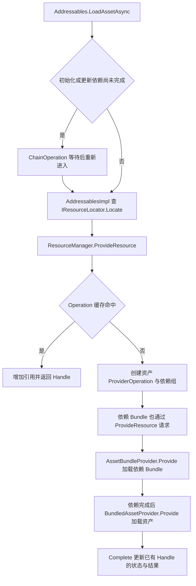

# 05 Addressables与AssetBundle

%% navigation-start %%
> [!abstract] 本页位置
> [[00 知识库首页|首页]] → [[资源与世界]] → **05 Addressables与AssetBundle**
> 按版本核实加载链，配对句柄与资源释放。
> [[05 Addressables与AssetBundle 导图.canvas|打开图谱]] · [[知识体系脑图|完整层级]] · [[模块依赖与关联|关联说明]]

> [!tip]- 本页知识点索引
> - [[05 Addressables与AssetBundle#地址与依赖图|地址与依赖图]]
> - [[05 Addressables与AssetBundle#引用计数与释放|引用计数与释放]]
> - [[05 Addressables与AssetBundle#循环引用与卸载|循环引用与卸载]]
> - [[05 Addressables与AssetBundle#Resources与启动|Resources与启动]]
> - [[05 Addressables与AssetBundle#粒度与抖动|粒度与抖动]]
> - [[05 Addressables与AssetBundle#经 1.21.21 包源码核对的加载链（Q096–Q097）|经 1.21.21 包源码核对的加载链（Q096–Q097）]]
> - [[05 Addressables与AssetBundle#释放与原生引用纠错（Q086–Q090）|释放与原生引用纠错（Q086–Q090）]]
> - [[05 Addressables与AssetBundle#Resources 的表与热更新边界（Q091–Q092）|Resources 的表与热更新边界（Q091–Q092）]]

%% navigation-end %%

本模块为归纳后的原理与实践建议。历史原问集中在 [[历史问题索引]]；无原文支持的扩展不视为用户问过。

## 地址与依赖图

Addressables 将地址映射到资源位置，底层可能使用 AssetBundle。分组不自动等于最优打包；共享依赖若重复进入不同 Bundle 会扩大体积和驻留。

**验证与验收：** 查看 Build Layout，记录共享纹理、材质与 Shader 的实际归属。

## 引用计数与释放

每次加载获得的句柄需要明确所有者与释放路径。LoadAssetAsync 后自行 Instantiate 的对象不应误用 ReleaseInstance；InstantiateAsync 的实例使用匹配的 ReleaseInstance 方式。释放句柄不等于该帧立刻归还全部内存。

**验证与验收：** 建立加载、失败、取消、销毁四条路径的资源配对表。

## 循环引用与卸载

资源间循环依赖应分析最终 Bundle 图与持有关系，而不是认为 C# GC 可以回收 Bundle。运行时共享依赖被其他有效句柄持有时不能被提前释放。

**验证与验收：** 用构建报告查强连通依赖组，比较拆分前后加载峰值。

## Resources与启动

Resources 中的资源会进入相关构建数据，但不意味着进入游戏就全部实例化。启动耗时应区分索引初始化、实际加载、解压、反序列化和业务初始化。

**验证与验收：** 记录启动各阶段时间，移除无用资源后对比包体和启动采样。

## 粒度与抖动

Bundle 太大增加加载粒度与峰值；太小增加文件、元数据和请求成本。频繁卸载重载共享依赖会造成资源抖动。缓存与滞回应结合场景轨迹验证。

**验证与验收：** 沿同一路线往返，记录 Bundle 重载次数和峰值。

## 关联

- [[03 内存与GC]]
- [[06 异步与生命周期]]
- [[07 场景流式与地形]]

任务入口：[[学习任务脑图]]；参考依据：[[参考资料与版本边界]]。

历史来源：[[历史问题索引#处理AssetBundle循环引用]]。

历史来源：[[历史问题索引#Resources目录与启动时间]]。

历史来源：[[历史问题索引#Unity Addressables 架构]]。

## 经 1.21.21 包源码核对的加载链（Q096–Q097）

本轮读取 Unity Registry 的 `com.unity.addressables@1.21.21`，这是核查样本，不代表实际项目包版本。历史的 LoadAssetOperation、ContentCatalogData.Locate 等“原样源码级链”不能照抄。

Handle 在请求发起后就返回，不是在全部加载完成后才返回。Locator 在初始化/更新时由 Catalog 建立，不是每次 LoadAsset 都重新下载 Catalog；key 可以是地址、GUID、标签等，位置本身也有 InternalId，不是“只存 key 不存路径”。Catalog 不应概括成固定 JSON 布局，构建分组 Schema 也不能当成运行 Catalog 固定字段。

`LoadAssetAsync<GameObject>` 加载 Prefab 资产，不会自动 Instantiate 或执行场景实例 Awake。缓存、依赖操作和 Provider 可以复用；不是所有节点都每帧轮询，也不是所有依赖都完全并行。

## 释放与原生引用纠错（Q086–Q090）

Addressables 1.21.21 默认 AssetBundleResource 释放分支调用 `UnloadAsync(true)` 或 `Unload(true)`，不是旧图固定写的 `Unload(false)`。单资产 Release 后，同 Bundle 仍有其他有效引用时，不能保证该资产独立卸载。普通 Instantiate 不会增加 Addressables 的引用计数，必须持有加载句柄直到所有依赖它的手动实例销毁；复制 Handle struct 也不会自动 Acquire。

原生 `AssetBundle.Unload(false)` 只卸载容器而保留已加载对象，再次加载可能得到重复资产；`Unload(true)` 会使仍被使用的资产失效。不要绕过 Addressables 手工卸载其 Bundle。

`Resources.UnloadUnusedAssets` 遍历 GameObject 层级、脚本组件和静态变量，**不检查脚本执行栈**；只存在于局部变量的引用不是可靠保活机制。Destroy 原生 MonoBehaviour 不意味着其托管包装立即不可达：异步状态机、事件和缓存仍可能持有它。运行时 new 的 Texture/Material/Mesh 应由创建者显式 Destroy；Addressables 资产由匹配的 Release 管理，不混用所有权。

残留排查用同一路径的前后快照与引用链。FindObjectsOfTypeAll 包含内置及 Editor 对象且会分配数组，数量未降不能独立证明泄漏；GetAllAssetNames 返回资产路径，不能用它与 Object.name 一一匹配。GC.Collect 不是每次卸载的必做步骤，也不能代替原生资源释放。

## Resources 的表与热更新边界（Q091–Q092）

构建时产生资源索引；运行时读取/初始化索引，不是扫描 Assets/Resources 目录重新发现文件。具体内存表结构、复杂度及资源数对应多少毫秒不能从概念 Dictionary 推定。旧回答的几十至几百毫秒没有实测依据。

Addressables 内容更新涉及 Catalog、Hash、Bundle 与版本兼容，并非“只换 Catalog”；失败回退、重复请求、断线恢复、缓存和磁盘预算仍需应用层设计。相关入口 [[无Loading副本与预加载卡顿]]，包来源见 [[参考资料与版本边界#本轮技术核查依据]]。

本轮复核结论见 [[知识点逐项核验]]；文档/源码版本依据见 [[技术核验来源]]。
