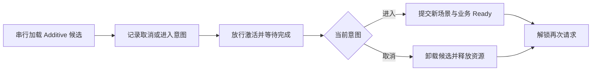

# 06 异步与生命周期

%% navigation-start %%
> [!abstract] 本页位置
> [[00 知识库首页|首页]] → [[运行时与内存]] → **06 异步与生命周期**
> await 不等于后台线程，取消不等于底层操作终止。
> [[06 异步与生命周期 导图.canvas|打开图谱]] · [[知识体系脑图|完整层级]] · [[模块依赖与关联|关联说明]]

> [!tip]- 本页知识点索引
> - [[06 异步与生命周期#协程与await|协程与await]]
> - [[06 异步与生命周期#UniTask机制|UniTask机制]]
> - [[06 异步与生命周期#取消与过期结果|取消与过期结果]]
> - [[06 异步与生命周期#异步加载仍可卡顿|异步加载仍可卡顿]]
> - [[06 异步与生命周期#场景激活与取消|场景激活与取消]]
> - [[06 异步与生命周期#状态机、续体与等待对象（Q021–Q026、Q115–Q117）|状态机、续体与等待对象（Q021–Q026、Q115–Q117）]]
> - [[06 异步与生命周期#停止协程不等于收尾完成（Q083–Q084）|停止协程不等于收尾完成（Q083–Q084）]]
> - [[06 异步与生命周期#场景逻辑取消的安全收尾（Q118–Q119）|场景逻辑取消的安全收尾（Q118–Q119）]]

%% navigation-end %%

本模块为归纳后的原理与实践建议。历史原问集中在 [[历史问题索引]]；无原文支持的扩展不视为用户问过。

## 协程与await

协程在 PlayerLoop 上恢复，yield 不会自动把 CPU 工作搬到后台。async 方法在遇到未完成的等待前仍同步执行；await 后续在哪个线程或阶段执行取决于等待对象与上下文。

**验证与验收：** 把重计算放在 await 前后分别采样，观察卡顿是否仍在主线程。

## UniTask机制

UniTask 使用值类型任务与 PlayerLoop 集成减少许多异步路径的分配；不代表任意组合绝对零分配。这些操作不为每个任务创建线程，但调度要区分重载：以 UniTask 2.5.9 为例，Delay 和带 CancellationToken 的 Yield 使用 PlayerLoopRunner；无 token 的 YieldAwaitable 经 ContinuationQueue；直接 await 原生 AsyncOperation 则由原生完成通知恢复。

**验证与验收：** 比较协程、Task 与 UniTask 的分配、恢复阶段与取消行为。

## 取消与过期结果

取消等待不一定取消底层加载。对象销毁、离开场景或新请求覆盖旧请求时，应通过 token 与 generation 校验阻止过期结果回写；迟到资源也必须按拥有权释放。

**验证与验收：** 模拟快速进出区域与重复点击，验证过期回调不创建孤儿对象。

## 异步加载仍可卡顿

I/O 等待可异步，但反序列化、对象创建、Awake/OnEnable、Shader 和 GPU 上传仍可能在关键线程造成峰值。控制并发与每帧实例化预算比简单多加 await 更有效。

**验证与验收：** 对比分帧创建与一次性创建的 P99 帧耗时及总加载时间。

## 场景激活与取消

allowSceneActivation=false 会暂停激活，不能视为通用取消机制；相关异步队列还可能被阻塞。退出等待后的场景和句柄必须收尾，不能让取消只改变界面状态。

**验证与验收：** 测试加载到激活前退出、快速重进和失败重试三条路径。

## 关联

- [[02 CPU与调度]]
- [[05 Addressables与AssetBundle]]
- [[07 场景流式与地形]]

任务入口：[[学习任务脑图]]；参考依据：[[参考资料与版本边界]]。

专项：[[无Loading副本与预加载卡顿]]。

历史来源：[[历史问题索引#UniTask 原理与卡顿]]。

历史来源：[[历史问题索引#Unity异步方案对比]]。

历史来源：[[历史问题索引#Unity yield return 讲解]]。

历史来源：[[历史问题索引#取消Unity场景加载]]。

## 状态机、续体与等待对象（Q021–Q026、Q115–Q117）

调用迭代器方法先得到 IEnumerator，第一次 MoveNext 才运行正文；StartCoroutine 通常立即推进到第一次 yield。C# 的 yield 还支持 IEnumerable、泛型迭代器，以及合适的异步迭代器，并非“只能写在 IEnumerator 方法”。自写调度器还需管理嵌套迭代器、异常、取消和释放。

UniTask 2.5.9 的 PlayerLoopRunner 管理 IPlayerLoopItem（如 Delay、带 token 的 YieldPromise），ContinuationQueue 管理无 token 的 YieldAwaitable 等续体。即使传入 CancellationToken.None，显式选择 token 重载也会走 YieldPromise；不能仅按方法名称分类。直接 await 原生 AsyncOperation 与 WithCancellation/ToUniTask 的恢复时机也可能不同，场景 Start 与 await 后续顺序要按所用版本核对。已完成的 await 可同步继续，完成通知也可能直接执行耗时续体。`Yield(Update)` 可能在当前帧后续阶段恢复，严格跨到下一帧应按版本使用 NextFrame。普通 UniTask 不应任意重复 await，需多消费者时明确使用支持该语义的任务源。

`foreach { 发起请求; yield return request; }` 是串行；先发起多个请求再等待可重叠执行，但 IO/解压/集成争用和并发限制意味着总时间不必等于各项耗时的最大值。原示例还漏了已加载依赖的 AddReference，正式资源管理器必须对所有成功获取的所有权计数，并合并“正在加载”的请求。

## 停止协程不等于收尾完成（Q083–Q084）

销毁宿主 MonoBehaviour 或停用其 GameObject 会停止该宿主协程，重新激活不自动恢复；仅 enabled=false 不会停止协程。若协程由常驻管理器启动，销毁被操作对象也不会自动停止管理器的协程。

UnityWebRequest 要由所有者在取消时 Abort 并 Dispose；不要依赖停止迭代器一定运行 using/finally。清理应幂等并清空引用，防止旧完成回调覆盖新请求；下载完成也不代表未 Dispose 的资源自动释放。Addressables Release 是放弃所有权，不是通用取消底层请求 API。

## 场景逻辑取消的安全收尾（Q118–Q119）

旧脚本在 `allowSceneActivation=false` 时退出协程，或继续等待另一场景加载，可能永久卡住异步队列。不能将其作为完整可用脚本继承。

建议由常驻管理器串行拥有操作：保留当前场景 → Additive 加载候选 → 取消时仅记录意图 → 放行候选激活并等到 isDone → 卸载候选 → 清理资源 → 恢复可重试状态；成功时再切换 Active Scene 和退出旧场景。取消的候选也可能执行 Awake/OnEnable，应由业务 Ready 门控阻止其开始战斗、音频或网络行为。Single 加载会影响旧场景，不宜用来承诺无副作用回退。

这是一份收尾设计，未在 Unity 内运行验证，不冒称补交了原历史所求的完整脚本。项目版本、异常与场景初始化门控还需实战确认。

本轮复核结论见 [[知识点逐项核验]]；文档/源码版本依据见 [[技术核验来源]]。
