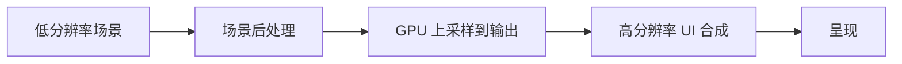

# 场景UI分辨率与RT带宽

%% navigation-start %%
> [!abstract] 本页位置
> [[00 知识库首页|首页]] → [[01 GPU与渲染]] → **场景UI分辨率与RT带宽**
> 把专项问题连回主模块；方案和待实测项以原文条件为准。
> [[专项实践地图.canvas|打开图谱]] · [[知识体系脑图|完整层级]] · [[模块依赖与关联|关联说明]]

> [!info] 交叉查阅
> [[01 GPU与渲染]] · [[08 UGUI与交互]] · [[04 纹理与资源]]
> 归档入口不等于所有知识点的唯一归属。

> [!tip]- 本页知识点索引
> - [[场景UI分辨率与RT带宽#分辨率的三种含义|分辨率的三种含义]]
> - [[场景UI分辨率与RT带宽#分离渲染路径|分离渲染路径]]
> - [[场景UI分辨率与RT带宽#分配成本与访问成本|分配成本与访问成本]]
> - [[场景UI分辨率与RT带宽#Bloom与移动GPU|Bloom与移动GPU]]
> - [[场景UI分辨率与RT带宽#合成路径与 RenderGraph 纠错（Q074–Q078）|合成路径与 RenderGraph 纠错（Q074–Q078）]]

%% navigation-end %%

来源：[[历史问题索引#Unity Camera Setup]]、[[历史问题索引#Unity纹理回退机制]]。

## 分辨率的三种含义

720p 通常指 1280×720，1080p 通常指 1920×1080；2K、4K 有不同场景下的命名习惯，应直接记录像素宽高。UI 设计分辨率用于布局参考，不等于物理输出像素。CanvasScaler 的参考尺寸也不保证每台设备都用相同像素密度。

## 分离渲染路径

场景渲染到低分辨率颜色目标，后处理与上采样后合成到输出，再以较高输出分辨率绘制 UI。CPU 安排命令，常规 Blit、上采样和混合由 GPU 执行。具体 Camera Stack、自定义 SRP Pass 和 RenderGraph 配置取决于管线版本，不能把 Built-in Camera 设置直接套到任意 SRP。

## 分配成本与访问成本

RT 分配后仍需要执行每帧颜色、深度读写。RGBA8 的 1920×1080 单层颜色约 7.91 MiB；深度、MSAA、HDR、mip 和多缓冲另算。一次全屏读写可产生更多流量，缓存和压缩会影响实际外部带宽，不能把理论字节数当实测流量。

RT 没释放表示资源还占用内存，并不自动触发绘制；Camera 是否继续渲染由渲染调度决定。临时 RT 用配对的 GetTemporary/ReleaseTemporary；持久 RT 依拥有权释放并销毁对象。

## Bloom与移动GPU

### Q027：不止 Bloom 的后处理

后处理通常由 CPU 配置参数/提交，由 GPU 执行像素处理；体积混合等 CPU 开销也应测量。URP14 中不要把每种效果都理解成一个独立全屏 Pass，管线可能合并处理。

|效果|输入与目的|重点成本/边界|
|---|---|---|
|Tonemapping|HDR 场景颜色映射到显示范围|不是简单改变分辨率；与曝光、颜色空间一起检查|
|Color Adjustments / Grading|颜色变换，可能使用 LUT|不能用滤镜名字推断 Pass 数|
|Depth of Field|场景色与深度，模拟焦外模糊|分辨率、采样与模式改变带宽/画质|
|Vignette|按屏幕位置调整边缘颜色|常可合入其他处理，不等同多次 Blit|
|SSAO|深度/法线估计屏幕空间遮蔽|URP14 是 Renderer Feature；法线来源与预通道也有代价|

[URP14 后处理入口](https://docs.unity3d.com/Packages/com.unity.render-pipelines.universal@14.0/manual/integration-with-post-processing.html)、[DoF](https://docs.unity3d.com/Packages/com.unity.render-pipelines.universal@14.0/manual/post-processing-depth-of-field.html)、[Tonemapping](https://docs.unity3d.com/Packages/com.unity.render-pipelines.universal@14.0/manual/post-processing-tonemapping.html)、[SSAO](https://docs.unity3d.com/Packages/com.unity.render-pipelines.universal@14.0/manual/post-processing-ssao.html)。未来对 Motion Blur 等效果应按实际包版本核实输入与运动矢量支持，不能从其他管线照搬。

Bloom 常先提亮区再逐级降采样、模糊、逐级升采样合成。降低分辨率能降低像素处理量。移动 Tile GPU 可在片上处理部分数据，但 Pass 间是否需要 Load/Store 取决于附件与依赖。RenderGraph 能基于显式资源依赖管理生命周期、复用和裁剪，不保证自动消除全部带宽成本。

关联：[[01 GPU与渲染]]、[[08 UGUI与交互]]、[[04 纹理与资源]]。

历史来源：[[历史问题索引#Unity纹理回退机制]]。

历史来源：[[历史问题索引#Unity Camera Setup]]。

## 合成路径与 RenderGraph 纠错（Q074–Q078）

URP Camera Stack 的 Overlay Camera 通常共享 Base 的目标，不能仅将 UI 放进 Overlay 就保证独立原生分辨率。优先核对当前版本 Render Scale 与 Screen Space Overlay；自定义 SRP 明确执行场景低分辨率 → 后处理 → 上采样 → 最终输出 UI，并在 Frame Debugger 查每阶段实际目标尺寸。UI 的设计参考坐标与输出像素仍须分开。

FSR2、DLSS、XeSS 等时域重建需要运动矢量、深度、抖动与历史管理，并非任意替换一次 Blit Shader；它们是备选方案，不是 FSR2→DLSS→XeSS 串行叠加。旧“下降 30–60%”没有项目实测依据。

RenderGraph 的正确依赖示意为 SceneColor 与 Depth→SSAO，AO 在照明/合成中使用；Bloom 读取场景亮度颜色，不能把 SSAO 黑白遮蔽纹理直接当 Bloom 的常规输入。Pass 裁剪、临时纹理复用/别名、异步计算依赖兼容条件；有副作用或导入资源的 Pass 可能需要显式保留，图不保证显存零额外成本或任意重排。

Graphics.Blit 的同源同目标反馈通常未定义，但 GPU 并非“完全不能原地改纹理”：固定混合、受支持的存储访问等是不同机制。全屏三角形仍有顶点着色工作，只是远小于重新绘制场景。API 选择考虑 XR、RTHandle、RenderGraph 与资源状态兼容性，不声称新接口在所有场景必然更快。

本轮复核结论见 [[知识点逐项核验]]；文档/源码版本依据见 [[技术核验来源]]。
