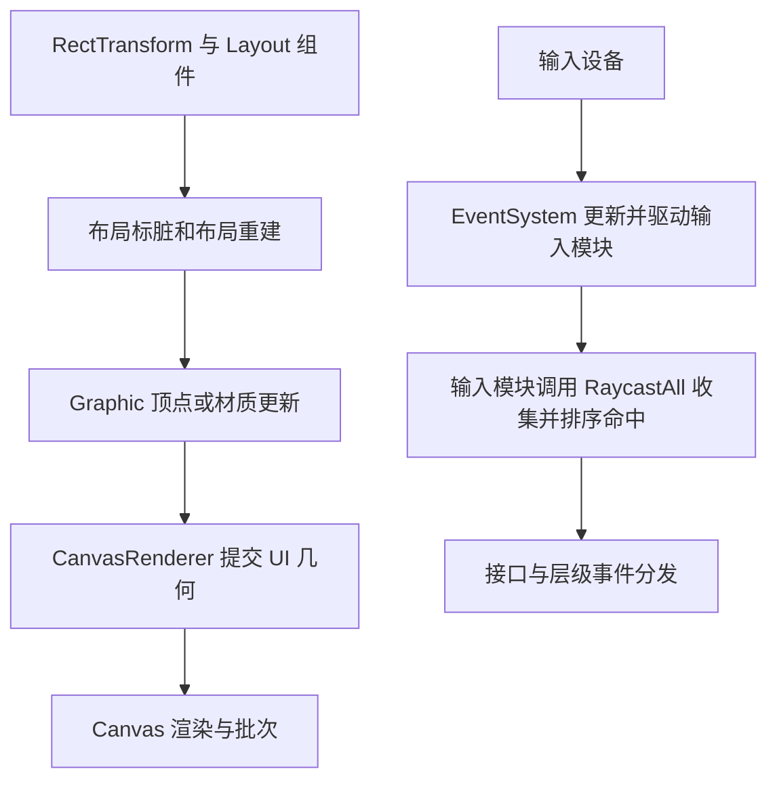
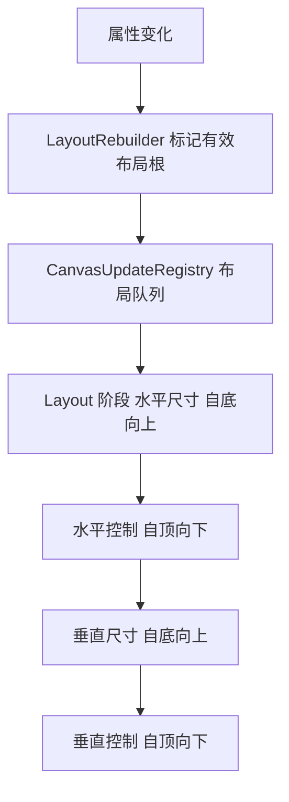
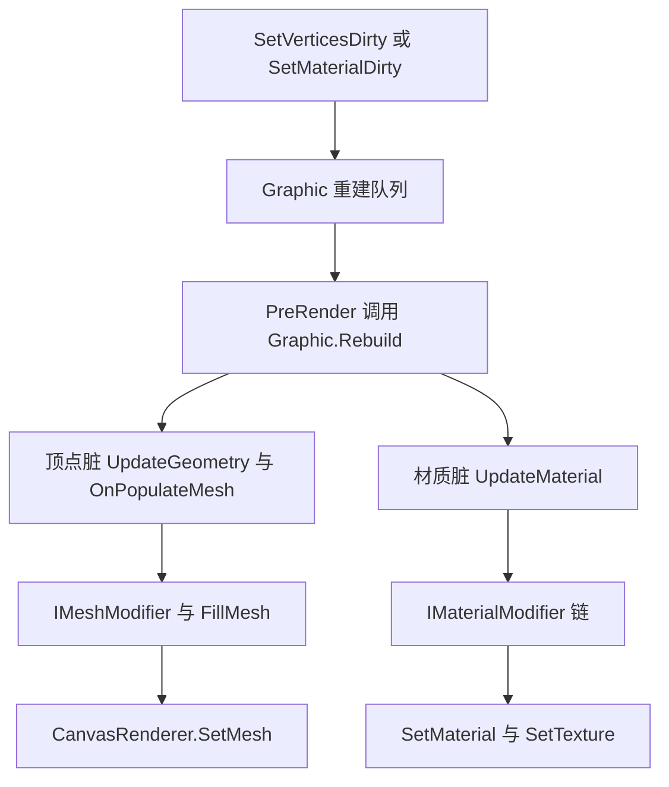
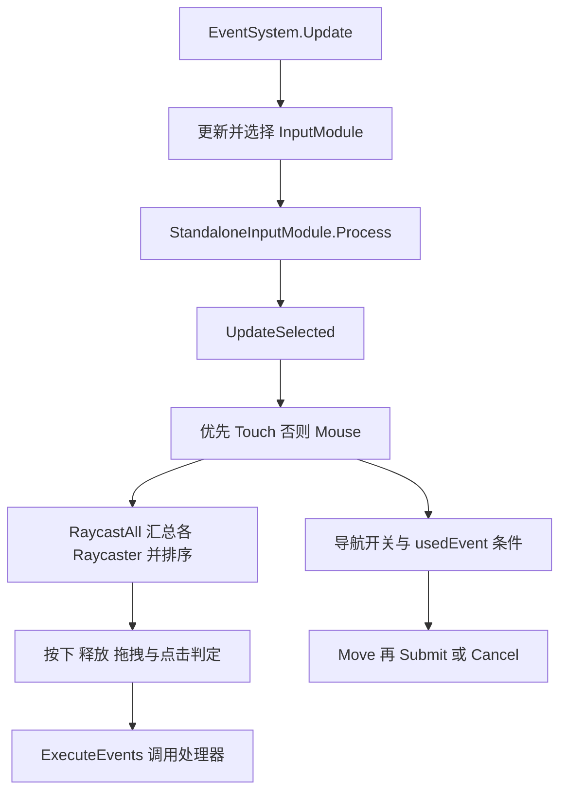
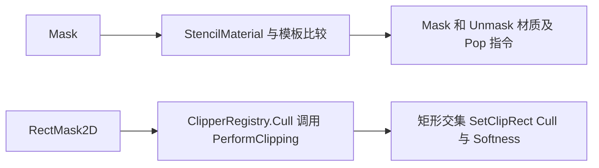
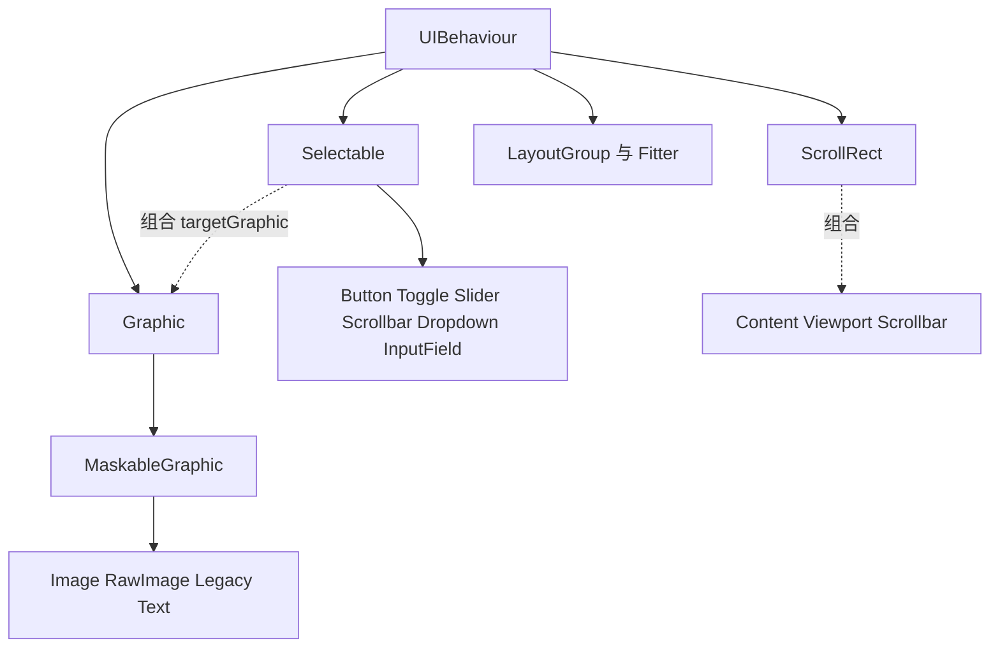

# UGUI架构与事件顺序

来源：多份 UGUI 架构与网格重建会话，见 [[历史问题索引]]。

LayoutGroup 计算子元素的位置尺寸，Graphic 根据 RectTransform 与内容生成渲染网格；“只移动子节点”不能替代图片切片、填充、文本字形等几何变化。CanvasUpdateRegistry 管理重建队列，具体阶段需对照项目 uGUI 包源码。

Mask 常利用模板机制与关联材质，RectMask2D 适用于矩形裁剪；不能简单认定某一个永远更快，需看层级、批次和覆盖区域。Selectable 负责选中与导航状态，显示组件和输入接口各有职责。

事件多条件排序通常是词典序：先比较高优先字段，仅相等时比较下一字段。不同 Raycaster 的相机深度、排序优先级、层级和距离规则依源码实现而定；不复写一份无版本保证的“原样源码”。

滚动列表虚拟化在历史面试问题中已被提出，所以属于已提及待实践，而非确定从未讨论。

关联：[[08 UGUI与交互]]、[[场景UI分辨率与RT带宽]]。

## 布局系统（独立图）

ILayoutElement 提供 min/preferred/flexible 尺寸；ILayoutController 应用布局，同一节点先 SelfController 再其他 Controller。ContentSizeFitter、AspectRatioFitter 是 SelfController，不能画成尺寸提供者；GridLayoutGroup 的 cellSize 自定。LayoutGroup 与 Fitter 并存不必然死循环，重点排查同一轴的互相驱动与深层反复标脏。

## Graphic 与材质（独立图）

GraphicRegistry 是 Canvas 的 Graphic 注册表，不是重建队列。已 cull 的 Graphic 可暂缓重建；Canvas 原生批次构建与 Graphic 的 C# 网格生成是不同阶段。源码是公开可查的，历史“所有 uGUI 源码都不能阅读或引用”的一概结论不成立；复用时仍按对应文件许可要求处理。

## 输入与分发（独立图）

这是 StandaloneInputModule 的链，不能当成 InputSystemUIInputModule 的逐函数顺序。触摸与鼠标会优先于导航；导航可能因前序事件已消耗而跳过。Execute 发给目标上有效处理器；ExecuteHierarchy 沿父链找到第一个能处理的对象后停止，不是 DOM 向所有祖先冒泡。点击还要核对按下对象、释放对象与拖拽状态，不等于首个 Raycast 命中立即 onClick。

## Mask 与矩形裁剪（独立图）

RectMask2D 不使用 Mask 的 Stencil 路径；部分裁剪由兼容 UI Shader 执行，不要求每次裁剪重新生成几何。两种 Mask 还可参加射线过滤，裁剪与点击判定要分开测。

## 继承与组合（独立图）

ScrollRect 不是 Selectable；控件与 Graphic 常是组合关系。TextMeshPro 有自己的类层次，图中的 Legacy Text 不能直接当作 TMP_Text。

## Raycast 比较器的版本条件（Q068–Q072）

以本轮固定的 uGUI 提交为准：不同 module 才比较相机 depth、sortOrderPriority、renderOrderPriority；再比较 SortingLayer 的排序值、sortingOrder；**仅 rootRaycaster 相同才比较 depth**；随后比较 distance，启用 PACKAGE_PHYSICS2D 时还可能比较 SortingGroup，最后以 index 打破平局。旧“等价源码”漏掉 rootRaycaster 条件，不能用于跨 Canvas 排序。

List.Sort 本身不保证稳定；index 只是比较器显式的最终排序键，不是把算法变成 stable sort。也不存在所有场景固定的“UI Raycaster 高于 PhysicsRaycaster”。排序与显示优先级相关，但不能断言任意自定义 Raycaster 都严格匹配最终像素遮挡。

核查源码：[uGUI 固定提交](https://github.com/Unity-Technologies/uGUI/tree/2f2223531d1e8177bcdf83c81f6c3aba1f9f14ab/com.unity.ugui/Runtime/UGUI)，涉及 EventSystem.cs、StandaloneInputModule.cs、Graphic.cs、CanvasUpdateRegistry.cs、LayoutRebuilder.cs。此提交含新版本功能，项目仍须对照其锁定的包；未在本地 Obsidian 或 Unity 运行。
