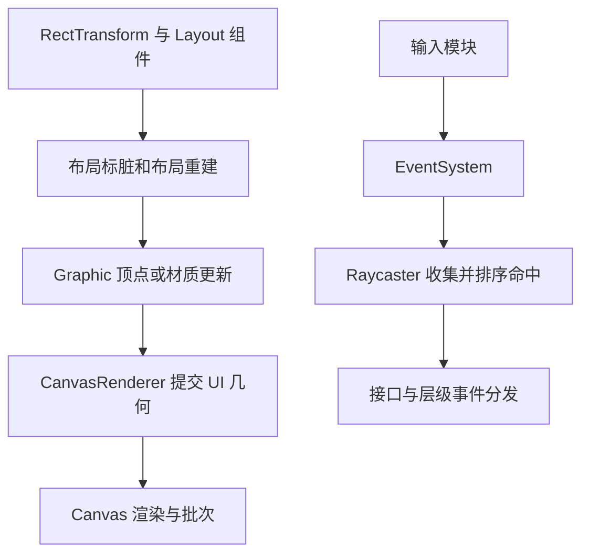

# UGUI架构与事件顺序

来源：多份 UGUI 架构与网格重建会话，见 [[历史问题索引]]。

LayoutGroup 计算子元素的位置尺寸，Graphic 根据 RectTransform 与内容生成渲染网格；“只移动子节点”不能替代图片切片、填充、文本字形等几何变化。CanvasUpdateRegistry 管理重建队列，具体阶段需对照项目 uGUI 包源码。

Mask 常利用模板机制与关联材质，RectMask2D 适用于矩形裁剪；不能简单认定某一个永远更快，需看层级、批次和覆盖区域。Selectable 负责选中与导航状态，显示组件和输入接口各有职责。

事件多条件排序通常是词典序：先比较高优先字段，仅相等时比较下一字段。不同 Raycaster 的相机深度、排序优先级、层级和距离规则依源码实现而定；不复写一份无版本保证的“原样源码”。

滚动列表虚拟化在历史面试问题中已被提出，所以属于已提及待实践，而非确定从未讨论。

关联：[[08 UGUI与交互]]、[[场景UI分辨率与RT带宽]]。
