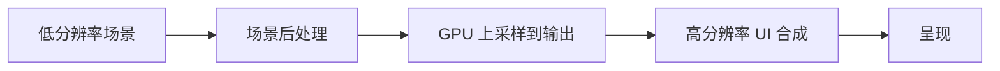

# 场景UI分辨率与RT带宽

来源：[[历史问题索引#Unity Camera Setup]]、[[历史问题索引#Unity纹理回退机制]]。

## 分辨率的三种含义

720p 通常指 1280×720，1080p 通常指 1920×1080；2K、4K 有不同场景下的命名习惯，应直接记录像素宽高。UI 设计分辨率用于布局参考，不等于物理输出像素。CanvasScaler 的参考尺寸也不保证每台设备都用相同像素密度。

## 分离渲染路径

场景渲染到低分辨率颜色目标，后处理与上采样后合成到输出，再以较高输出分辨率绘制 UI。CPU 安排命令，常规 Blit、上采样和混合由 GPU 执行。具体 Camera Stack、自定义 SRP Pass 和 RenderGraph 配置取决于管线版本，不能把 Built-in Camera 设置直接套到任意 SRP。

## 分配成本与访问成本

RT 分配后仍需要执行每帧颜色、深度读写。RGBA8 的 1920×1080 单层颜色约 7.91 MiB；深度、MSAA、HDR、mip 和多缓冲另算。一次全屏读写可产生更多流量，缓存和压缩会影响实际外部带宽，不能把理论字节数当实测流量。

RT 没释放表示资源还占用内存，并不自动触发绘制；Camera 是否继续渲染由渲染调度决定。临时 RT 用配对的 GetTemporary/ReleaseTemporary；持久 RT 依拥有权释放并销毁对象。

## Bloom与移动GPU

Bloom 常先提亮区再逐级降采样、模糊、逐级升采样合成。降低分辨率能降低像素处理量。移动 Tile GPU 可在片上处理部分数据，但 Pass 间是否需要 Load/Store 取决于附件与依赖。RenderGraph 能基于显式资源依赖管理生命周期、复用和裁剪，不保证自动消除全部带宽成本。

关联：[[01 GPU与渲染]]、[[08 UGUI与交互]]、[[04 纹理与资源]]。

历史来源：[[历史问题索引#Unity纹理回退机制]]。

历史来源：[[历史问题索引#Unity Camera Setup]]。
