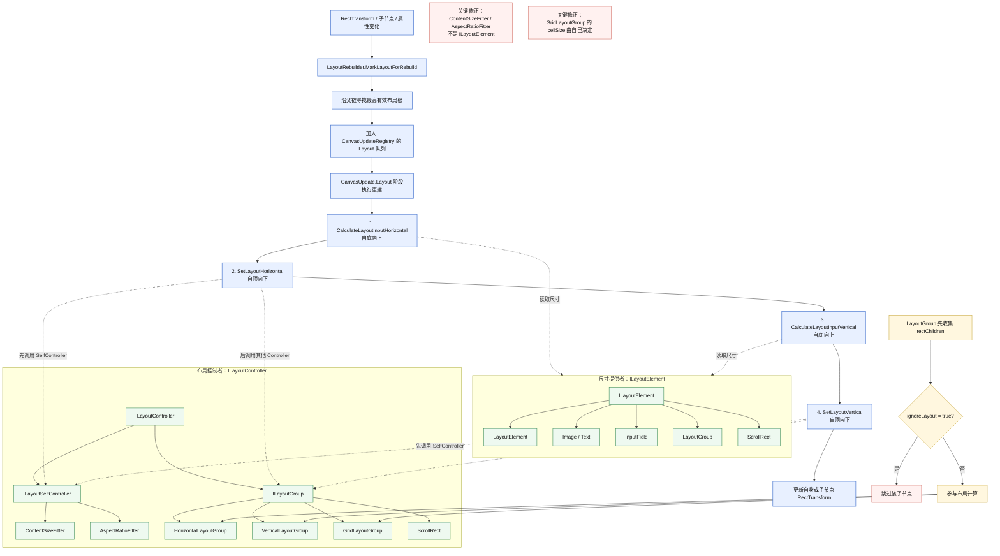
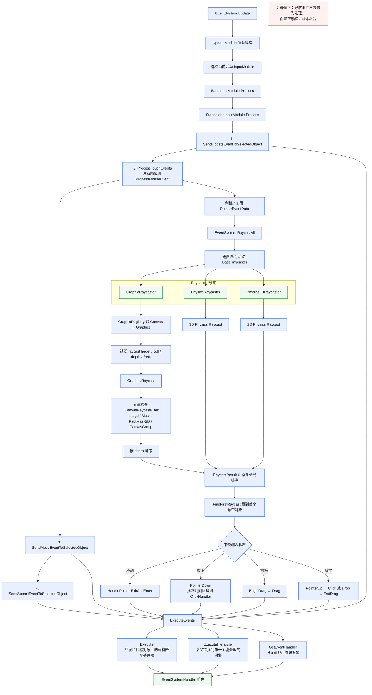
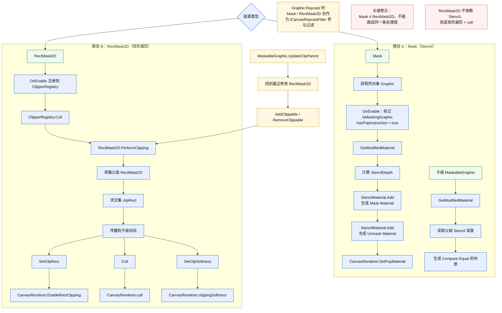
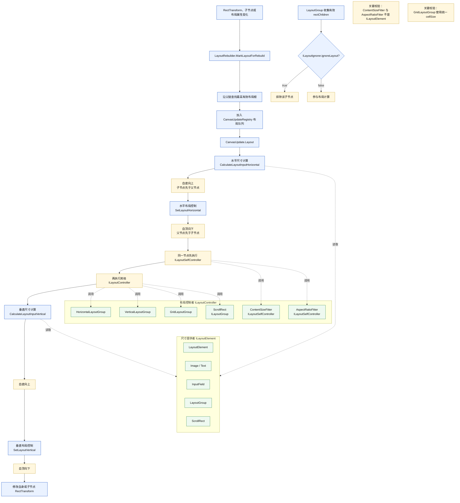
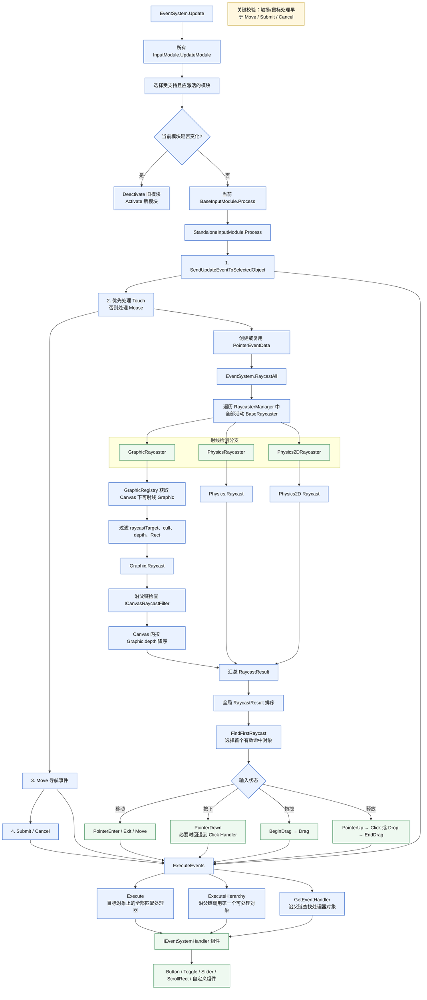
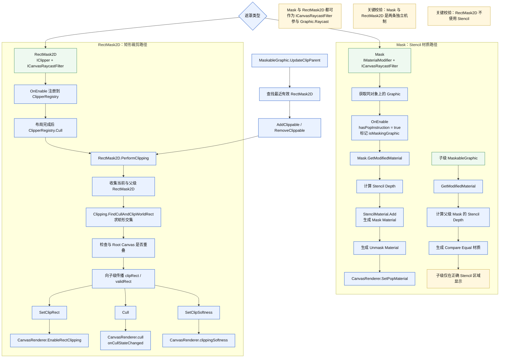
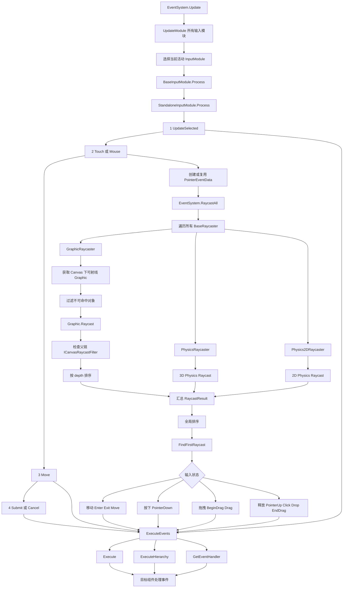

# 分支 · Unity UGUI 架构图

会话 ID：`6a5dadfb-17e4-83ee-b047-74741ede7e2a`

返回页：`{"order": "newest_first", "limit": 10, "nextCursor": null, "hasMore": false}`

## 轮次 99b8773d-4323-41f4-a67b-8ebd5058543e

### 用户

拆开,不要合并成一张, 同时验证它的 正确性 和 完整性, 表现性最好好看一点

### 助手

下面按模块拆开给出 5 张独立架构图。每张图都按 uGUI 官方源码关系重新核对过，并把容易画错的点单独标出来。

### 模块 3：Layout 布局系统

校验要点：  
`ContentSizeFitter`、`AspectRatioFitter` 都属于 `ILayoutSelfController`，不是 `ILayoutElement`。`HorizontalLayoutGroup`、`VerticalLayoutGroup`、`GridLayoutGroup` 属于 `ILayoutGroup`。`GridLayoutGroup` 使用统一 `cellSize`，子节点尺寸不会反过来决定单元格大小。    



---

### 模块 4：Graphic 网格与材质渲染

校验要点：  
`Graphic` 通过 `CanvasUpdateRegistry` 进入图形重建；顶点脏走 `UpdateGeometry`，材质脏走 `UpdateMaterial`。几何生成后会调用同对象上的 `IMeshModifier.ModifyMesh`，材质会通过 `IMaterialModifier.GetModifiedMaterial` 链式修改，然后交给 `CanvasRenderer`。  

```mermaid
flowchart TB
    classDef core fill:#e8f0ff,stroke:#4a78d0,stroke-width:1.4px,color:#111;
    classDef impl fill:#eef9f0,stroke:#3f8f5a,stroke-width:1.2px,color:#111;
    classDef note fill:#fff7df,stroke:#c7a63a,stroke-width:1.1px,color:#111;
    classDef warn fill:#fff1f0,stroke:#d06a5f,stroke-width:1.1px,color:#111;

    A[Graphic 属性 / 尺寸 / 纹理 / 状态变化]:::core --> B{Dirty 类型}:::core
    B -->|顶点| C1[SetVerticesDirty]:::core
    B -->|材质| C2[SetMaterialDirty]:::core
    B -->|布局| C3[SetLayoutDirty]:::core

    C1 --> D[CanvasUpdateRegistry 图形队列]:::core
    C2 --> D
    D --> E[CanvasUpdate.PreRender]:::core
    E --> F[Graphic.Rebuild]:::core

    F --> G1{m_VertsDirty?}:::core
    G1 -->|是| H1[UpdateGeometry]:::core
    H1 --> I1[OnPopulateMesh(VertexHelper)]:::core
    I1 --> J1[Graphic / Image / RawImage / Text<br/>各自生成顶点]:::impl
    J1 --> K1[依次调用 IMeshModifier.ModifyMesh]:::impl
    K1 --> L1[VertexHelper.FillMesh(workerMesh)]:::core
    L1 --> M1[CanvasRenderer.SetMesh]:::core

    F --> G2{m_MaterialDirty?}:::core
    G2 -->|是| H2[UpdateMaterial]:::core
    H2 --> I2[获得 base material]:::core
    I2 --> J2[materialForRendering<br/>遍历 IMaterialModifier 链]:::impl
    J2 --> K2[CanvasRenderer.SetMaterial]:::core
    K2 --> L2[CanvasRenderer.SetTexture(mainTexture)]:::core

    subgraph VisualTypes[主要显示组件]
        direction TB
        V1[Graphic]:::impl
        V2[MaskableGraphic]:::impl
        V3[Image]:::impl
        V4[RawImage]:::impl
        V5[Legacy Text]:::impl
        V1 --> V2
        V2 --> V3
        V2 --> V4
        V2 --> V5
    end

    J1 -.由具体类型实现.-> VisualTypes
    J2 -.常见修改者.-> N1[Mask / MaskableGraphic]:::note

    M1 --> R[CanvasRenderer]:::core
    L2 --> R
    R --> S[Unity 原生 UI 渲染层]:::core
    S --> T[最终提交到渲染管线 / GPU]:::core

    W1[GraphicRegistry 维护 Canvas 下 Graphic 集合<br/>主要给 GraphicRaycaster 用]:::note
    W2[注意：GraphicRegistry 不是重建队列]:::warn
```

---

### 模块 5：EventSystem 输入、射线与事件派发

校验要点：  
`StandaloneInputModule.Process` 的真实顺序是：先 `SendUpdateEventToSelectedObject`，再处理触摸或鼠标，最后才是导航的 `Move / Submit / Cancel`。命中对象来自 `EventSystem.RaycastAll`，而派发依赖 `ExecuteEvents.Execute / ExecuteHierarchy / GetEventHandler`。   



---

### 模块 6：Mask 与 RectMask2D 遮罩裁剪

校验要点：  
`Mask` 和 `RectMask2D` 是两条不同机制。`Mask` 走 `IMaterialModifier + StencilMaterial`，会生成 mask / unmask 材质并配置 `CanvasRenderer` 的 pop material。`RectMask2D` 走 `IClipper.PerformClipping`，计算矩形裁剪区域，向子级传播 `SetClipRect / Cull / SetClipSoftness`。  



---

### 模块 7：控件、显示组件与接口体系

校验要点：  
`Button`、`Toggle`、`Slider`、`Scrollbar`、`Dropdown`、`InputField` 都继承 `Selectable`；但 `ScrollRect` 不是 `Selectable`，它直接继承 `UIBehaviour`，并实现拖拽、滚动、布局和 Canvas 接口。显示组件这边则是 `Graphic -> MaskableGraphic -> Image / RawImage / Text`。          

```mermaid
flowchart TB
    classDef core fill:#e8f0ff,stroke:#4a78d0,stroke-width:1.4px,color:#111;
    classDef impl fill:#eef9f0,stroke:#3f8f5a,stroke-width:1.2px,color:#111;
    classDef note fill:#fff7df,stroke:#c7a63a,stroke-width:1.1px,color:#111;
    classDef warn fill:#fff1f0,stroke:#d06a5f,stroke-width:1.1px,color:#111;

    A[MonoBehaviour]:::core --> B[UIBehaviour]:::core

    subgraph Visual[显示组件分支]
        direction TB
        B --> G1[Graphic<br/>+ ICanvasElement]:::impl
        G1 --> G2[MaskableGraphic<br/>+ IClippable / IMaskable / IMaterialModifier]:::impl
        G2 --> G3[Image<br/>+ ILayoutElement + ICanvasRaycastFilter]:::impl
        G2 --> G4[RawImage]:::impl
        G2 --> G5[Legacy Text<br/>+ ILayoutElement]:::impl
    end

    subgraph Controls[Selectable 控件分支]
        direction TB
        B --> S1[Selectable<br/>Move / PointerDown-Up / Enter-Exit / Select-Deselect]:::impl
        S1 --> S2[Button<br/>+ PointerClick + Submit]:::impl
        S1 --> S3[Toggle<br/>+ PointerClick + Submit + ICanvasElement]:::impl
        S1 --> S4[Slider<br/>+ Drag + InitializePotentialDrag + ICanvasElement]:::impl
        S1 --> S5[Scrollbar<br/>+ BeginDrag + Drag + InitializePotentialDrag + ICanvasElement]:::impl
        S1 --> S6[Legacy Dropdown<br/>+ PointerClick + Submit + Cancel]:::impl
        S1 --> S7[Legacy InputField<br/>+ UpdateSelected + Drag + Click + Submit<br/>+ ICanvasElement + ILayoutElement]:::impl
    end

    subgraph Other[其他重要独立分支]
        direction TB
        B --> O1[ScrollRect<br/>+ Drag + Scroll + ICanvasElement<br/>+ ILayoutElement + ILayoutGroup]:::impl
        B --> O2[LayoutGroup<br/>+ ILayoutElement + ILayoutGroup]:::impl
        O2 --> O3[HorizontalOrVerticalLayoutGroup]:::impl
        O3 --> O4[HorizontalLayoutGroup]:::impl
        O3 --> O5[VerticalLayoutGroup]:::impl
        O2 --> O6[GridLayoutGroup]:::impl
        B --> O7[ContentSizeFitter<br/>+ ILayoutSelfController]:::impl
        B --> O8[AspectRatioFitter<br/>+ ILayoutSelfController]:::impl
        B --> O9[LayoutElement<br/>+ ILayoutElement + ILayoutIgnorer]:::impl
    end

    subgraph Composition[常见组合关系]
        direction TB
        C1[Selectable.targetGraphic]:::note --> G1
        C2[Toggle 使用 Graphic / ToggleGroup]:::note --> S3
        C3[Slider 使用 FillRect / HandleRect]:::note --> S4
        C4[Scrollbar 使用 HandleRect]:::note --> S5
        C5[Dropdown 内部选项项常由 Toggle 承担]:::note --> S6
        C6[InputField 依赖 Text / Placeholder / Caret]:::note --> S7
        C7[ScrollRect 依赖 Content / Viewport / Scrollbar]:::note --> O1
    end

    W1[关键修正：ScrollRect 不是 Selectable 子类]:::warn
    W2[关键修正：控件既要看继承，也要看实现的事件 / 布局接口]:::warn
```



如果你要，我下一条可以继续把这 5 张图再升级成“适合面试讲解”的版本：每张图下再补一段“调用时序 + 常见易错点”。

## 轮次 24ec85bd-0440-4ab9-a4dc-85eb644f27bb

### 用户

上面有几个 显示不出来

### 助手

已重新生成 5 张独立交互图：Layout、Graphic 渲染、EventSystem、遮罩裁剪、控件与接口体系。

## 轮次 9ce226f7-6132-45fe-b893-9022f8106dd9

### 用户

上面 的 5张 图 分开 生成 给我,不要偷懒

### 助手

下面 5 张图完全分开给你。每张都是独立的 Mermaid 图。

### 图 1：Layout 布局系统



---

### 图 2：Graphic 网格与材质渲染

```mermaid
flowchart TB
    classDef core fill:#EAF2FF,stroke:#4A78D0,stroke-width:1.5px,color:#111;
    classDef impl fill:#EEF9F0,stroke:#3F8F5A,stroke-width:1.2px,color:#111;
    classDef note fill:#FFF7DF,stroke:#C7A63A,stroke-width:1.1px,color:#111;

    A[Graphic 属性、纹理、尺寸或状态变化]:::core --> B{Dirty 类型}:::core
    B -->|顶点| C1[SetVerticesDirty<br/>m_VertsDirty = true]:::core
    B -->|材质| C2[SetMaterialDirty<br/>m_MaterialDirty = true]:::core
    B -->|布局| C3[SetLayoutDirty<br/>进入 Layout 系统]:::core

    C1 --> D[CanvasUpdateRegistry 图形队列]:::core
    C2 --> D
    D --> E[CanvasUpdate.PreRender]:::core
    E --> F[Graphic.Rebuild]:::core
    F --> G{CanvasRenderer 存在且未被 cull?}:::core
    G -->|否| H[跳过本次生成]:::note
    G -->|是| I{检查脏标记}:::core

    I -->|m_VertsDirty| J1[UpdateGeometry]:::core
    J1 --> J2[具体 Graphic.OnPopulateMesh]:::core
    J2 --> J3[写入共享 VertexHelper]:::core
    J3 --> J4[依次调用 IMeshModifier.ModifyMesh]:::impl
    J4 --> J5[VertexHelper.FillMesh(workerMesh)]:::core
    J5 --> J6[CanvasRenderer.SetMesh]:::core
    J6 --> J7[m_VertsDirty = false]:::note

    I -->|m_MaterialDirty| K1[UpdateMaterial]:::core
    K1 --> K2[取得 Graphic.material]:::core
    K2 --> K3[materialForRendering<br/>依次调用 IMaterialModifier]:::impl
    K3 --> K4[CanvasRenderer.SetMaterial]:::core
    K4 --> K5[CanvasRenderer.SetTexture(mainTexture)]:::core
    K5 --> K6[m_MaterialDirty = false]:::note

    subgraph Types[Graphic 类型]
        direction LR
        T1[Graphic]:::impl --> T2[MaskableGraphic]:::impl
        T2 --> T3[Image]:::impl
        T2 --> T4[RawImage]:::impl
        T2 --> T5[Legacy Text]:::impl
    end

    J2 -.由具体类型实现.-> Types
    J6 --> R[CanvasRenderer]:::core
    K5 --> R
    R --> S[Unity 原生 UI 渲染层]:::core
    S --> U[渲染管线 / GPU]:::core

    N1[GraphicRegistry 维护 Canvas 下 Graphic 集合]:::note
    N2[关键校验：GraphicRegistry 不是重建队列]:::note
```

---

### 图 3：EventSystem 输入、射线与事件派发



---

### 图 4：Mask 与 RectMask2D 遮罩裁剪



---

### 图 5：控件、显示组件与接口体系

```mermaid
flowchart TB
    classDef base fill:#EAF2FF,stroke:#4A78D0,stroke-width:1.5px,color:#111;
    classDef visual fill:#EEF9F0,stroke:#3F8F5A,stroke-width:1.2px,color:#111;
    classDef control fill:#F4EEFF,stroke:#8059B2,stroke-width:1.2px,color:#111;
    classDef other fill:#FFF7DF,stroke:#C7A63A,stroke-width:1.1px,color:#111;
    classDef note fill:#FFF1F0,stroke:#D06A5F,stroke-width:1.1px,color:#111;

    A[MonoBehaviour]:::base --> B[UIBehaviour]:::base

    subgraph VisualBranch[显示组件分支]
        direction TB
        B --> V1[Graphic<br/>ICanvasElement]:::visual
        V1 --> V2[MaskableGraphic<br/>IClippable + IMaskable + IMaterialModifier]:::visual
        V2 --> V3[Image<br/>ILayoutElement + ICanvasRaycastFilter]:::visual
        V2 --> V4[RawImage]:::visual
        V2 --> V5[Legacy Text<br/>ILayoutElement]:::visual
    end

    subgraph SelectableBranch[Selectable 控件分支]
        direction TB
        B --> S1[Selectable<br/>Move / PointerDown-Up / Enter-Exit / Select-Deselect]:::control
        S1 --> S2[Button<br/>PointerClick + Submit]:::control
        S1 --> S3[Toggle<br/>PointerClick + Submit + ICanvasElement]:::control
        S1 --> S4[Slider<br/>Drag + InitializePotentialDrag + ICanvasElement]:::control
        S1 --> S5[Scrollbar<br/>BeginDrag + Drag + InitializePotentialDrag + ICanvasElement]:::control
        S1 --> S6[Legacy Dropdown<br/>PointerClick + Submit + Cancel]:::control
        S1 --> S7[Legacy InputField<br/>UpdateSelected + Drag + Click + Submit<br/>ICanvasElement + ILayoutElement]:::control
    end

    subgraph IndependentBranch[其他独立 UIBehaviour 分支]
        direction TB
        B --> O1[ScrollRect<br/>Drag + Scroll + ICanvasElement<br/>ILayoutElement + ILayoutGroup]:::other
        B --> O2[LayoutGroup<br/>ILayoutElement + ILayoutGroup]:::other
        O2 --> O3[HorizontalOrVerticalLayoutGroup]:::other
        O3 --> O4[HorizontalLayoutGroup]:::other
        O3 --> O5[VerticalLayoutGroup]:::other
        O2 --> O6[GridLayoutGroup]:::other
        B --> O7[ContentSizeFitter<br/>ILayoutSelfController]:::other
        B --> O8[AspectRatioFitter<br/>ILayoutSelfController]:::other
        B --> O9[LayoutElement<br/>ILayoutElement + ILayoutIgnorer]:::other
        B --> O10[EventSystem]:::other
        B --> O11[BaseInputModule]:::other
        B --> O12[BaseRaycaster]:::other
    end

    subgraph Composition[常见组合关系：不是继承]
        direction LR
        C1[Selectable.targetGraphic]:::visual --> V1
        C2[Toggle 状态 Graphic + ToggleGroup]:::visual --> S3
        C3[Slider FillRect + HandleRect]:::visual --> S4
        C4[Scrollbar HandleRect]:::visual --> S5
        C5[Dropdown Template + Item Toggle]:::visual --> S6
        C6[InputField Text + Placeholder + Caret]:::visual --> S7
        C7[ScrollRect Content + Viewport + Scrollbar]:::visual --> O1
    end

    N1[关键校验：ScrollRect 不继承 Selectable]:::note
    N2[关键校验：理解控件体系要同时看继承、接口、组合关系]:::note
```



如果你这次还看到有某一张渲染不出来，我下一条就只发那一张的“纯简化版 Mermaid”，把兼容性优先放到最高。

## 轮次 20f3b834-c76e-448b-ad49-98cca01cdaf8

### 用户

图 3：EventSystem 输入、射线与事件派发 没显示出来

### 助手

单独给你重发 **图 3**，这次我把结构压缩了，尽量保证能显示。

### 图 3：EventSystem 输入、射线与事件派发（简化兼容版）



这一张的核心含义是：

`EventSystem.Update → InputModule.Process → RaycastAll → 找到命中对象 → ExecuteEvents 派发给处理器`

你要是愿意，我下一条可以把这张再拆成两张：  
**3-1 输入与射线检测**，**3-2 ExecuteEvents 派发机制**。

## 轮次 d9561b14-6cde-473b-9e56-d2060b08b80a

### 用户

给我一个总的架构图, 画好看点

### 助手

已生成一张 UGUI 总体分层架构图，按“输入事件链、UI 组件层、布局/重建链、渲染生成链、遮罩裁剪链、UnityEngine 原生层”组织。

