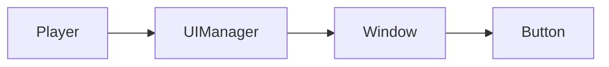

# UGUI 架构图解析

会话 ID：`6a5c8748-72c8-83ee-97d9-e037ef5103fb`

返回页：`{"order": "newest_first", "limit": 10, "nextCursor": null, "hasMore": false}`

## 轮次 372f1bc8-6971-48e2-bb06-fb7a3cf32fb2

### 用户

在ChatGPT中有哪些适合画代码架构图的插件

### 助手

如果是在 **ChatGPT** 里面画**代码架构图、流程图、类图**，目前比较常用的方式有下面几种。

| 方式 | 适合 | 优点 | 缺点 |
|------|------|------|------|
| Mermaid | 架构图、流程图、时序图 | 文本生成、GitHub 原生支持、Markdown 可直接显示 | 样式一般 |
| PlantUML | UML、类图、ER 图 | UML 功能最全 | 语法较复杂 |
| Graphviz (DOT) | 大型架构图 | 自动布局效果好 | 学习成本较高 |
| D2 | 云架构、系统架构 | 语法简单、美观 | 生态不如 Mermaid |
| Structurizr DSL | C4 架构 | 专业软件架构 | 偏架构师使用 |
| Excalidraw | 手绘风格 | 漂亮、适合演示 | 不是纯文本 |

### 1. Mermaid（最推荐）
几乎已经成为事实标准。

支持：
- Flowchart
- Class Diagram
- Sequence Diagram
- State Diagram
- ER Diagram
- Gantt
- MindMap
- Architecture

例如：



适合：
- Unity
- 后端
- 微服务
- UGUI
- MVC
- MVVM
- ECS

---

### 2. PlantUML（画 UML 最强）

例如类图：

```plantuml
class Graphic
class MaskableGraphic
class Image

Graphic <|-- MaskableGraphic
MaskableGraphic <|-- Image
```

特别适合：
- 类图
- 时序图
- 状态机
- 用例图
- 组件图

如果做源码分析，它比 Mermaid 更专业。

---

### 3. D2（近几年很流行）

例如：

```d2
Player -> UIManager
UIManager -> Window
Window -> Button
```

优点：
- 自动布局漂亮
- 云架构很好看
- 比 Mermaid 更现代

---

### 4. Structurizr DSL（架构师推荐）

如果画：

- C4 Model
- 微服务
- 分布式系统

几乎都是用它。

例如：

```text
Software System
    Container
        Component
```

---

### 5. Excalidraw（最适合讲解）

不是代码生成，而是：

```
┌───────────────┐
│ Canvas        │
├───────────────┤
│ Graphic       │
├───────────────┤
│ Image         │
└───────────────┘
```

很多技术博客、课程都是用它画的。

---

## ChatGPT 中是否有插件？

目前 ChatGPT 没有一个官方专门用于“代码架构图”的内置插件，但可以直接让 ChatGPT 生成：

- Mermaid
- PlantUML
- D2
- Graphviz DOT
- Structurizr DSL

然后复制到对应工具中渲染即可。

---

## 如果你是 Unity 工程师（结合你的场景）

建议掌握优先级：

1. **Mermaid** —— 日常开发、Markdown 文档、GitHub README、设计文档。
2. **PlantUML** —— 阅读 Unity 源码、类继承关系、UML 图。
3. **Excalidraw** —— 面试、技术分享、培训。
4. **D2** —— 项目整体架构、模块关系图。

其中，**Mermaid + PlantUML** 基本可以覆盖 **90% 以上** 的 Unity 开发文档和源码分析需求。

## 轮次 1ec968dc-8d81-44eb-aef5-796895c6f5a0

### 用户

重画

### 助手

这是重新绘制的 **Unity UGUI 整体架构图**，涵盖了事件系统、UI 重建流程、布局系统以及最终渲染流程。

## 轮次 b117faed-61bc-435a-a96c-390fac81eaae

### 用户

详细一点，要区分出不同模块和类的关系

### 助手

这是更偏源码视角的 **Unity UGUI 核心类关系图**，展示了事件系统、渲染系统、布局系统、组件继承关系以及 Canvas 重建流程之间的核心类及其依赖关系。

## 轮次 47b2348a-ca87-457f-98db-679be85534e4

### 用户

更详细一些

### 助手

这是更接近 UGUI 源码目录结构的一级架构图，将 EventSystem、Graphic、Layout、Render、Mask 五大模块拆分，并展示了它们之间的主要类继承、依赖关系以及渲染和事件流向。

## 轮次 a95aa6c5-8900-4ac9-9e1d-3e6071c2de59

### 用户

有报错

### 助手

已修复 Mermaid 语法错误，主要去掉了 Mermaid 不支持的带标签虚线连接（如 `-.implements.->`），改为标准连接方式，并保持了各模块之间的关系。

